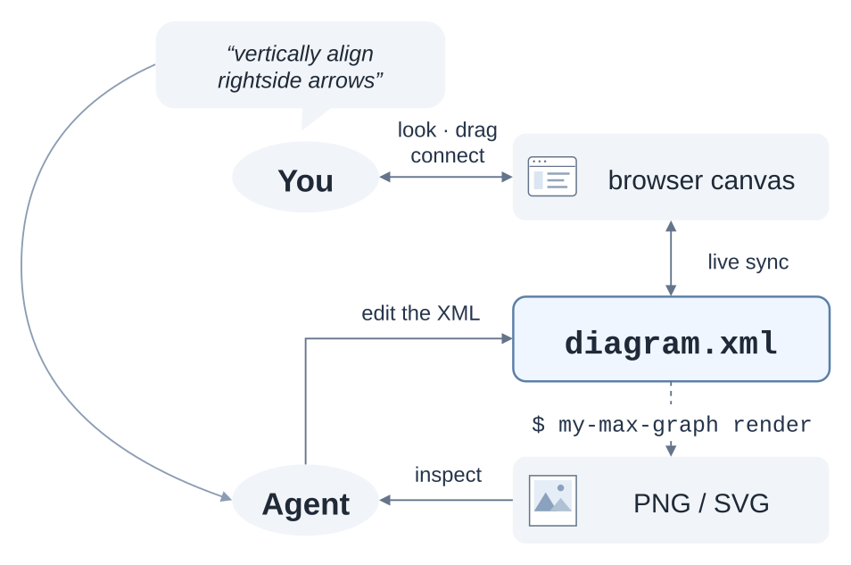

# my-max-graph

My tooling over [maxGraph][max-graph] for working on diagrams with an agent.




## Overview

I need boxes and arrows. I need them version controlled, and I need them accessible to other people and to agents. [maxGraph][max-graph] is great for this because it is open source, its diagrams are just XML, and it is the successor to mxGraph, which powers the popular [draw.io][draw-io] diagram tool.

My main use case is to diagram non-trivial software systems. [Mermaid][mermaid] is great for small things, but ultimately doesn't offer the richness, flexibility and information density that we can get with more powerful diagramming tools. This repository is my own tooling over maxGraph, to make it easy to view and edit a maxGraph diagram. 

This is designed for my own personal use. It is not a goal to invent yet another diagramming tool, but instead to tailor an existing tool (maxGraph) with some ergonomics that fit my exact needs so that I can (hopefully) get repeated use from it. I want a really tight view/edit/review loop that both me and an agent can collaborate on.


## Usage

This is what it looks like to use `my-max-graph` in the view/edit/review loop.

1. Pre-requisite: Install `my-max-graph`
   - Follow the instructions in [DEVELOPMENT.md](DEVELOPMENT.md).
2. Create a diagram
   - ```shell
     my-max-graph new my-diagram.xml
     ```
3. Serve it and view it in the browser
   - ```shell
     my-max-graph my-diagram.xml
     ```
   - Click the printed link to view the diagram in the browser.
4. Edit the XML (you or an agent)
   - Edit the XML by hand in a text editor, or ask your agent to make edits.
5. Render and inspect
   - ```shell
     my-max-graph render my-diagram.xml
     ```
   - This renders the diagram from its XML definition into a PNG or SVG file, which you or the agent can view.
   - Then, repeat the view/edit/review loop until you're done. 


## Guiding Principles

My vision has gotten clearer on this over time as I've attempted this project in fits and starts. Here are some guiding principles that help me keep this project well-scoped and to my needs.

- The browser is for looking and coarse changes
   - I don't want to maintain a bunch of rich GUI controls. I only need the ability to drag boxes, connect arrows, and add new boxes and arrows. I don't need a control plane for styles, moving elements forward/backward, or having much of any text input. Procedural work can be delegated to the CLI, like running auto-layout, universally upping/decreasing font size, etc. Much other work can be delegated to the LLM.  
- Detail and custom work is direct XML edits
   - Before agents, this would have been a tough sell. But with agents, they can do a ton of tedious stuff and very quickly. We can review the changes by looking at the rendered diagram and the XML diff. We can even hand-edit the XML when needed.


## Reference

- [maxGraph][max-graph]
- [draw.io][draw-io]

[max-graph]: https://github.com/maxGraph/maxGraph
[draw-io]: https://github.com/jgraph/drawio
[mermaid]: https://github.com/mermaid-js/mermaid
