# Concept diagram gallery

Ten tellings of the same story: a person and an agent iterating on one diagram
file. Every diagram here is dogfood — the source of truth is maxGraph XML, and
the checked-in SVG was produced by `my-max-graph render`. An agent wrote the
XML, rendered it, looked at the PNG, and adjusted, the same way it would for
any diagram in this repository.

Each example has deliberately separate forms:

- `*.xml` is the editable maxGraph source of truth.
- [`rendered/`](rendered/) contains checked-in SVG output from that XML. PNG
  output is generated alongside it for local visual inspection and ignored by Git.
- [`reference-svg/`](reference-svg/) preserves the original hand-authored SVGs
  as design targets for the five recreations.

1. Regenerate every checked-in render without touching the references
   - ```shell
     for source in diagrams/*.xml; do
       name="$(basename "$source" .xml)"
       my-max-graph render "$source" \
         --out "diagrams/rendered/$name.png" \
         --svg "diagrams/rendered/$name.svg"
     done
     ```

The gallery has two wings. The first five recreate the original hand-drawn
concepts in XML, faithful to their design targets. The next five are
deliberately non-uniform — a poster, a sequence diagram, a flowchart, a
capability map, and a timeline — because the point of the tool is range, not a
house style.


## Rendering pipeline

[One gear diagram and explanation](rendering-pipeline.md) follow XML through SVG,
cropping, and PNG, including where Chromium and native resvg do the measuring.


## The original five, recreated

Five deliberately different readings of the same workflow. Each keeps the
connector language neutral and orthogonal so that color describes elements —
not relationships. Together they exercise a small, reusable maxGraph
vocabulary: nested cells for mixed-weight labels, fixed edge anchors,
orthogonal routing, explicit waypoints, edge-label offsets, and a
free-standing dashed edge used as a lane divider.

| Interpretation | Emphasis |
|---|---|
| **1. Balanced actors** | You and the agent act as equal collaborators around one shared artifact. |
| **2. Continuous flow** | The work is a compact, repeatable lifecycle. |
| **3. Shared workspace** | The XML is the source of truth, surrounded by people and projections. |
| **4. Relay** | Intent and implementation cross a clear human/agent hand-off. |
| **5. Twin feedback loops** | Two independent review loops meet at the same diagram. |


### 1. Balanced actors

[Editable XML](01-balanced-actors.xml) · [Rendered SVG](rendered/01-balanced-actors.svg) · [Hand-authored reference](reference-svg/01-balanced-actors.svg)

| XML-derived render | Hand-authored target |
|---|---|
| 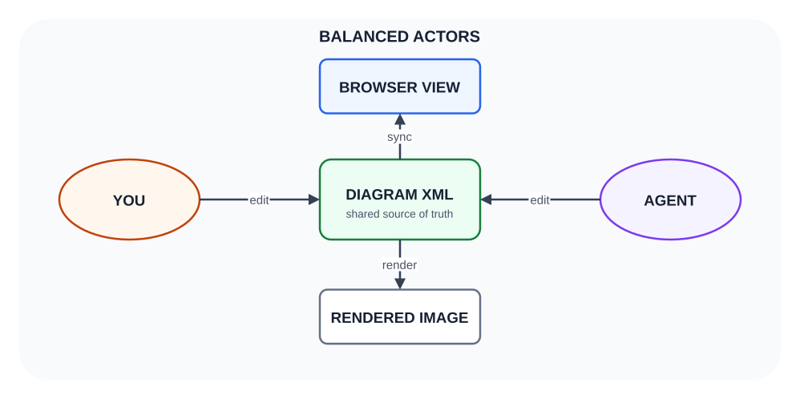 | 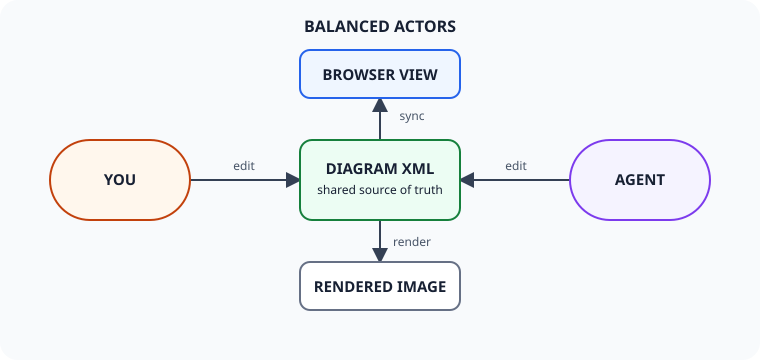 |


### 2. Continuous flow

[Editable XML](02-continuous-flow.xml) · [Rendered SVG](rendered/02-continuous-flow.svg) · [Hand-authored reference](reference-svg/02-continuous-flow.svg)

| XML-derived render | Hand-authored target |
|---|---|
| 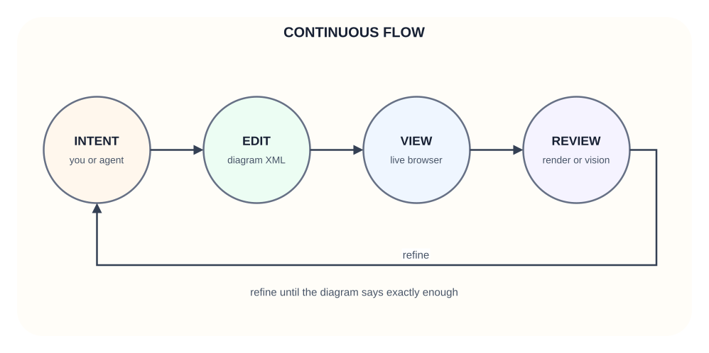 | 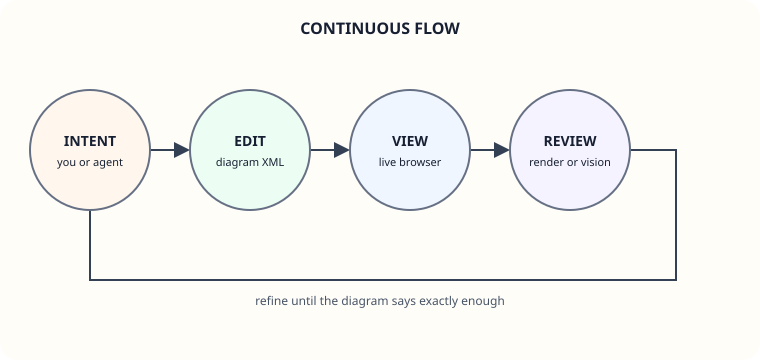 |


### 3. Shared workspace

[Editable XML](03-shared-workspace.xml) · [Rendered SVG](rendered/03-shared-workspace.svg) · [Hand-authored reference](reference-svg/03-shared-workspace.svg)

| XML-derived render | Hand-authored target |
|---|---|
| 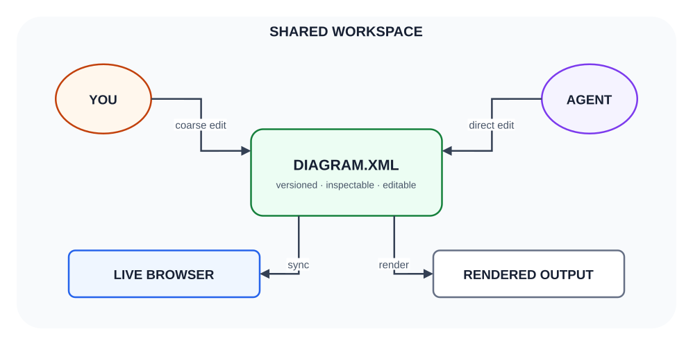 | 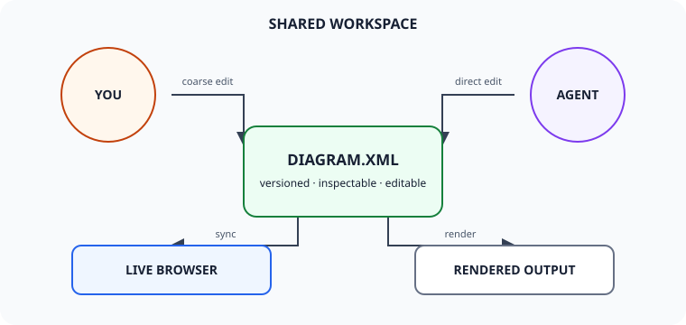 |


### 4. Relay

[Editable XML](04-relay.xml) · [Rendered SVG](rendered/04-relay.svg) · [Hand-authored reference](reference-svg/04-relay.svg)

| XML-derived render | Hand-authored target |
|---|---|
| 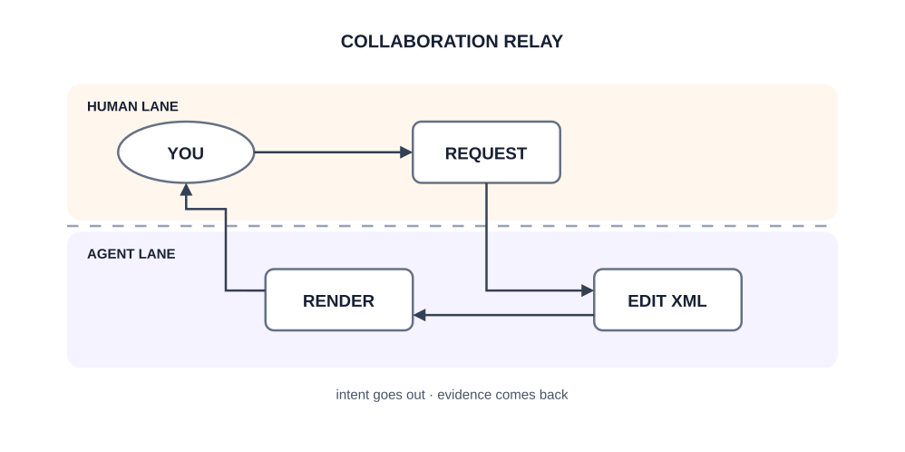 | 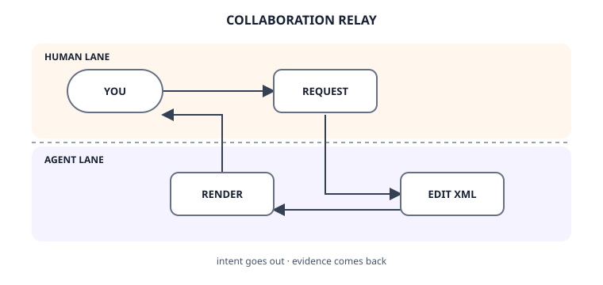 |


### 5. Twin feedback loops

[Editable XML](05-twin-loops.xml) · [Rendered SVG](rendered/05-twin-loops.svg) · [Hand-authored reference](reference-svg/05-twin-loops.svg)

| XML-derived render | Hand-authored target |
|---|---|
| 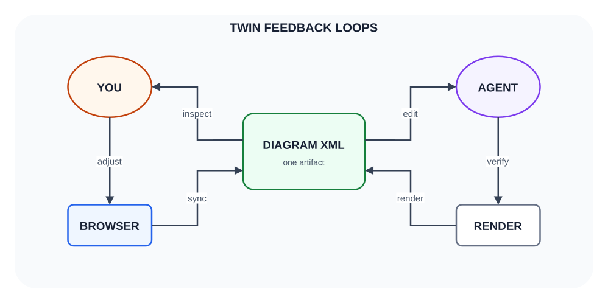 | 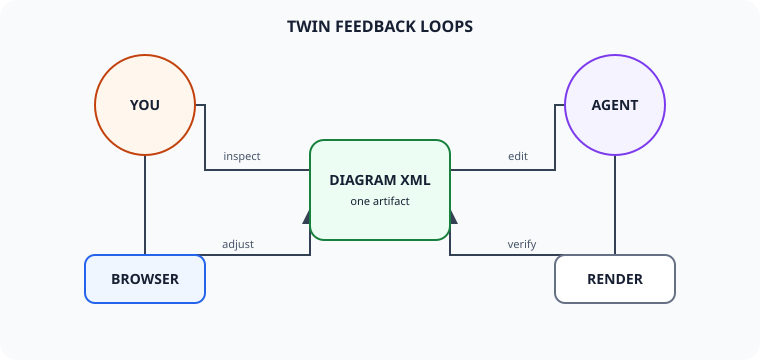 |


## Five more forms

Five disparate points of view on the same collaboration, sharing one actor
palette (you = red, browser = blue, diagram XML = green, agent = violet,
render = yellow) so the set coheres while the forms differ.

| Diagram | Form | Angle |
|---|---|---|
| [Same file, same picture](same-file-same-picture.xml) | poster | The one-sentence pitch. |
| [One round](one-round.xml) | sequence diagram | Every hop in a single edit round, in time order. |
| [Agent self-check](agent-self-check.xml) | flowchart | The agent's private render-and-look loop. |
| [Control surfaces](control-surfaces.xml) | capability map | What each collaborator's hands are on. |
| [Converging timeline](converging-timeline.xml) | annotated git log | The artifact improving diff by diff. |


### Same file, same picture

The leanest statement of the idea. The two thumbnails are identical on
purpose: the browser canvas and the rendered PNG are two projections of the
same XML, so both collaborators are always judging the same picture.

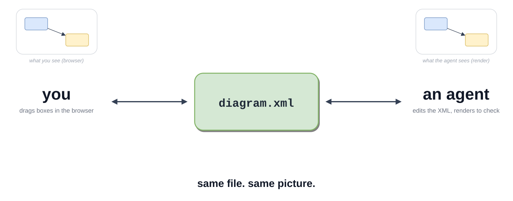


### One round

The most detailed view: one full round of collaboration as a sequence diagram.
You nudge a box in the browser; you ask the agent for a change in plain
language; the agent edits the XML, renders, catches its own mistake in the
PNG, and fixes it; the browser syncs the result back to your eyes.

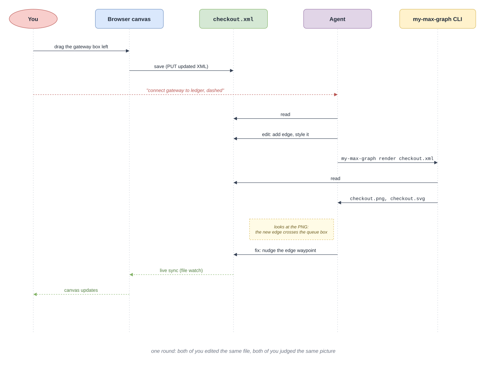


### Agent self-check

The loop from the agent's side of the table. The decisive step is the dark
one: `my-max-graph render` gives the agent the same pixels you see, so "does
it match intent?" is a question it can answer itself — as many rounds as it
takes — before handing anything back to you.

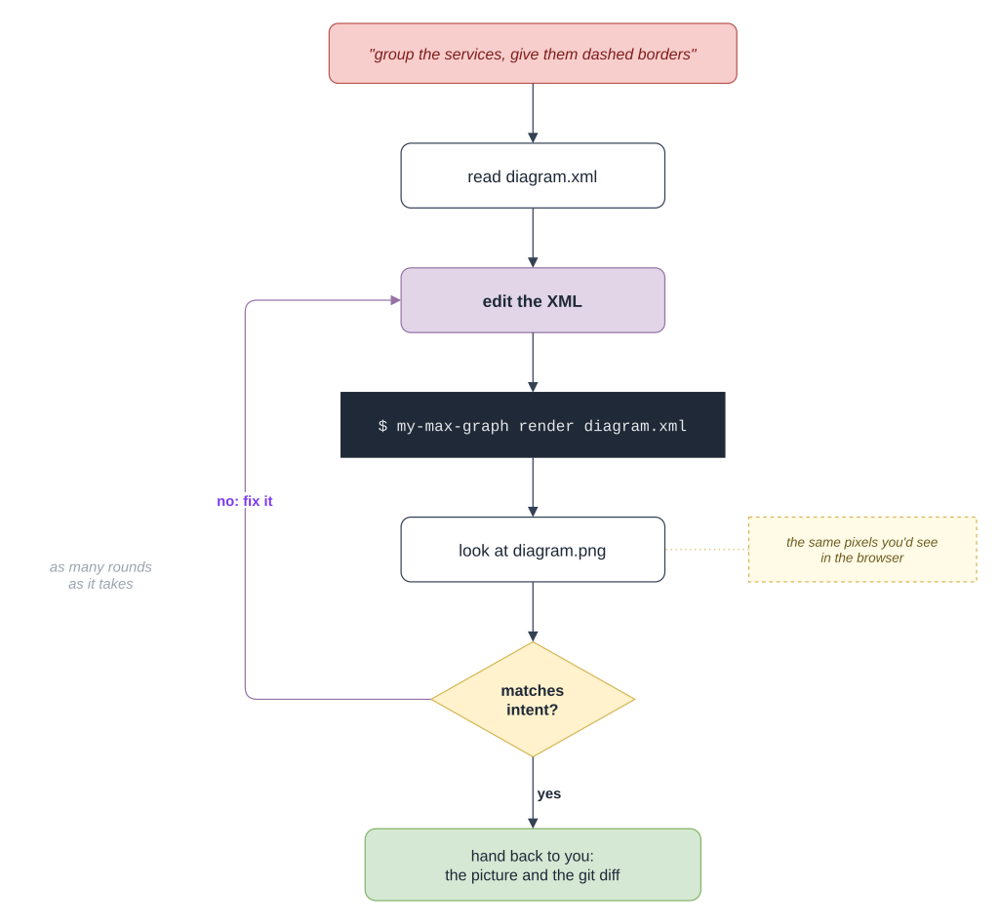


### Control surfaces

The two collaborators do not use the same controls, and that is the design.
Your surface is the browser: coarse, spatial, immediate. The agent's surface
is the repo and the CLI: precise, tireless, verifiable. Both are wired to the
same file.

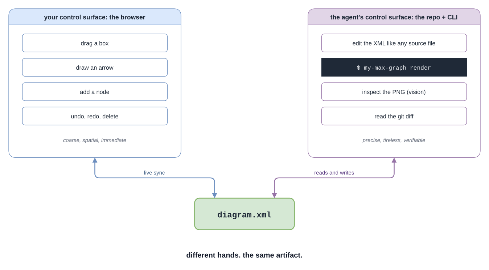


### Converging timeline

Because the diagram is a text file, its history is a git history. Five small
diffs — some from browser drags, some from XML edits, one from the agent's own
render-and-look catch — converge on a diagram worth keeping.

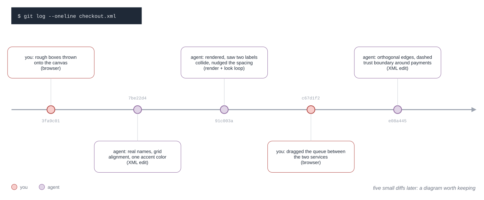
